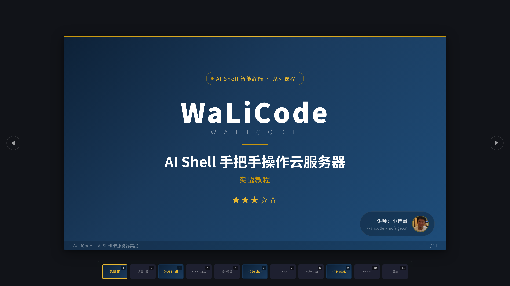
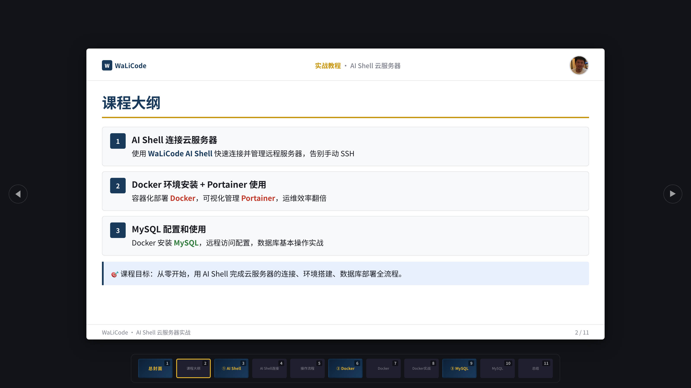
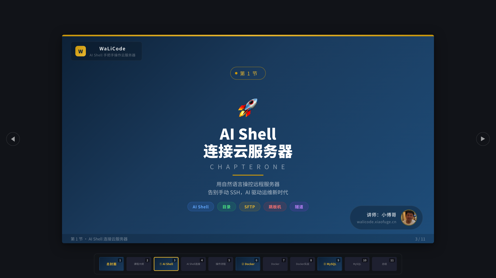
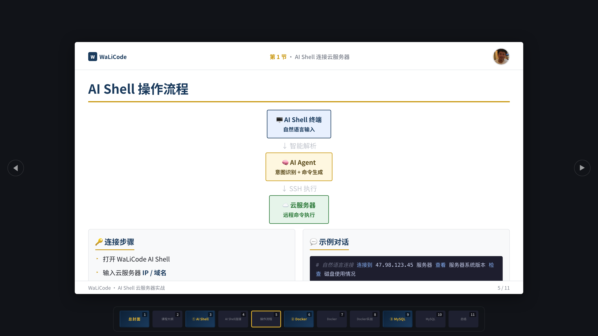
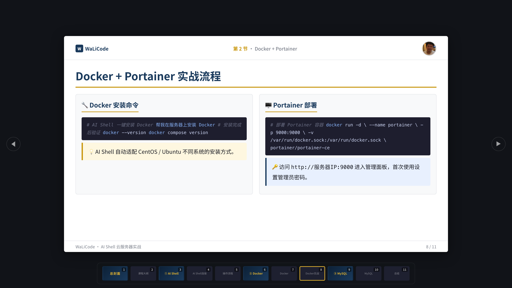
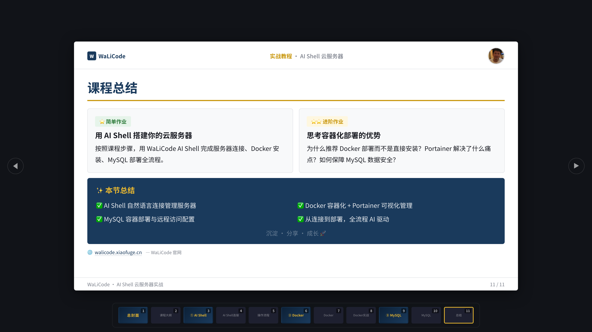

# xfg-skills-html2ppt · HTML PPT 生成技能

> **把课程内容，讲成一套可以翻页的深色科技风幻灯片。**

xfg-skills-html2ppt 是一个 HTML PPT 生成引擎：输入课程/演讲大纲，输出一份**单文件、零依赖、可直接放映**的 HTML 演示文稿。专为课程教学、技术分享、视频录制（B站/小红书）设计——深蓝+金色影院质感，每个章节封面可独立作视频封面，键盘/点击/缩略图三种方式翻页。



一套 HTML PPT 长这样：

- **总封面** — 深蓝渐变 + 金色装饰线，课程徽章、超大项目名、讲师卡片（毛玻璃 + 头像），首屏即海报
- **课程大纲** — 步骤流展示章节脉络，重点词三色高亮，课程目标一句话点题
- **章节封面** — 每节独立封面：章节图标 + 大号标题 + 五色能力标签胶囊，可直接裁成视频封面
- **内容页** — 卡片网格、架构图、双栏代码、提示框（tip/info/warn）等丰富组件
- **缩略图导航** — 底部常驻毛玻璃缩略条，11 页内容一眼定位，点击直达
- **单文件交付** — 一个 HTML 包含全部样式与脚本，双击即开：离线可用、可入库存档、可直接发给任何人

而这一切对生成方只有一个约束：**生成 = 换数据，不改引擎。**给 AI Agent 用，也给你自己用。

---

## 你可以用它做出什么

| 场景 | 输入 | 产出 |
|---|---|---|
| **课程教学** | 一门课的章节大纲 + 讲师信息 | 多章节课件：总封面 → 大纲 → 章节封面 → 内容页 → 总结作业 |
| **技术分享** | 一个主题 + 核心要点 | 会议演讲稿：架构图 + 代码演示 + 要点卡片 |
| **视频录制** | 系列课程的分节规划 | 每节独立封面即视频头图，B站/小红书直接用 |
| **培训汇报** | 汇报内容 + 数据要点 | 结构化演示页：步骤流 + 双栏对比 + 总结页 |

一句话：**凡是"按页推进才能讲清楚"的内容，都可以做成一套 HTML PPT**——写课件、做分享、录视频、开组会，都在射程内。

## 一个真实案例

仓库 `case/` 下有一套完整的 11 页课程 PPT——《WaLiCode · AI Shell 手把手操作云服务器》，浏览器直接打开：

**`case/walicode-ai-shell-course.html`**
3 节课程内容：AI Shell 连接云服务器 → Docker + Portainer → MySQL 配置使用。展示能力：多章节结构如何组织一门课、架构图与代码实战如何同页呈现、章节封面如何兼作视频头图。支持 `?slide=N` 直接跳页，如 `walicode-ai-shell-course.html?slide=5`。

实拍截图（真实渲染效果）：

**① 课程大纲页** —— 步骤流展示三节课程脉络，重点词蓝/红/绿三色高亮，课程目标一句话点题：



**② 章节封面** —— 每节独立封面：章节图标 + 大号标题 + 五色能力标签胶囊（AI Shell / SFTP / 跳板机 / 隧道），左上角毛玻璃课程品牌卡，右下角讲师信息卡——裁下来就是视频封面：



**③ 架构图页** —— 终端 → AI Agent → 云服务器三层架构图（蓝/金/绿语义配色），下方双栏"连接步骤 + 示例对话"，代码块带语法高亮：



**④ 代码实战页** —— 双栏代码对照：Docker 安装命令 ↔ Portainer 部署命令，命令/注释/字符串分色，配合提示框补充关键信息：



**⑤ 课程总结页** —— 简单/进阶双作业卡片 + 深蓝总结面板（金色标题 + ✅ 要点清单）+ 官网链接，收尾即沉淀：



页面底部常驻**缩略图导航条**：11 页缩略图一键直达，当前页金色描边——录视频时观众随时知道课程进度。

## 快速开始

```bash
# 1. 体验成品：浏览器打开案例
open case/walicode-ai-shell-course.html

# 2. 校验生成的 PPT（页码、缩略图、CSS 类一致性）
python3 scripts/validate.py case/walicode-ai-shell-course.html
python3 scripts/validate.py <你的-ppt.html> --strict

# 3. 安装为 Agent 技能（对话式生成）
cp -r xfg-skills-html2ppt ~/.workbuddy/skills/    # WorkBuddy
cp -r xfg-skills-html2ppt ~/.claude/skills/       # Claude Code
```

安装后在对话里直接说：

- 「帮我做一个 HTML PPT，主题是《Spring Boot 入门实战》，分3节：环境搭建 / REST API / 数据持久化，讲师小傅哥」
- 「把这份大纲做成课程 PPT，每节要有独立封面」
- 「生成一套适合录 B 站视频的技术分享幻灯片」

## 生成管线（它如何工作）

```
内容分析 → 页面规划 → 模板填充 → 一致性校验 → 单文件交付
   │           │           │            │
 识别章节    总封面→大纲→   只替换模板中   validate.py
 与页面类型  章节封面→内容   slide 结构    0 错误才交付
            →总结的固定动线
```

- **引擎不动**：`assets/template.html` 是渲染引擎 + 示例数据，生成时替换页面数据区（标题、章节、卡片、代码、架构图），保留全部样式与交互脚本。
- **页面动线固定**：总封面 → 课程大纲 → 章节封面 → 内容页 → 总结，页码连续（`N / 总数`），封面页与内容页的页脚格式统一。
- **组件可组合**：卡片网格 / 双栏 / 步骤流 / 架构图 / 代码块 / 提示框 / 作业卡，按内容自由拼装，CSS 类名见 `references/specification.md`。

## 质量保障（validate.py 检查项）

- 页码连续性与总数一致性（页脚 `N / M` ↔ 缩略图数量）
- 章节封面必须使用 `slide-chapter-cover` 类，封面页必须含金色装饰线
- 缩略图导航与 slide id 一一对应，防"点击没反应"
- `--strict` 模式：未使用的 CSS 类、缺失的必需页面（总封面/大纲/总结）一并拦截

## 目录结构

```
xfg-skills-html2ppt/
├── SKILL.md                      # 技能入口：页面类型、设计规范、生成工作流
├── assets/
│   └── template.html             # 渲染引擎 + 完整示例数据（11 页课程 PPT）
├── references/
│   ├── specification.md          # CSS 类名与组件 API 速查
│   └── best-practices.md         # 设计最佳实践
├── scripts/
│   └── validate.py               # 结构校验工具（0 错误才可交付）
└── case/                         # 完整案例，浏览器直接打开
    ├── walicode-ai-shell-course.html  # 11 页课程 PPT（支持 ?slide=N 跳页）
    └── screenshots/                   # 案例实拍截图（README 引用）
```

## License

Apache-2.0
